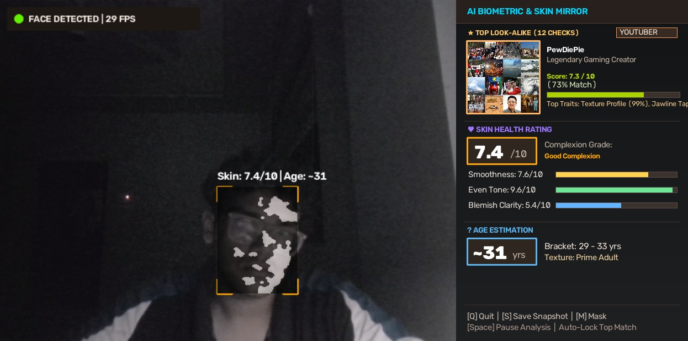

<div align="center">

# 🪞 FaceCard

### **AI-Powered Biometric Mirror: Real-Time Skin Evaluator & Celebrity Matcher**

[](https://www.python.org/)
[](https://opencv.org/)
[-brightgreen.svg)](https://github.com/opencv/opencv_zoo)
[](LICENSE)
[](https://github.com/)

<p align="center">
  <b>An end-to-end Computer Vision biometric mirror that quantifies skin health, classifies age & demographics, and maps 12 craniofacial geometric proportions to a 120-celebrity gallery in real time.</b>
</p>

---



*Figure 1: FaceCard Live Execution HUD — Tracking facial landmarks, evaluating skin quality metrics, estimating biological age, and locking onto an anthropometric look-alike match.*

---

</div>

## 📑 Table of Contents

- [Overview](#-overview)
- [Key Features](#-key-features)
- [Repository Structure](#-repository-structure)
- [Quick Start](#-quick-start)
  - [1. Installation](#1-installation)
  - [2. One-Click Launchers](#2-one-click-launchers)
  - [3. Manual Execution](#3-manual-execution)
- [Interactive Keyboard Shortcuts](#-interactive-keyboard-shortcuts)
- [How It Works (Technical Pipeline)](#-how-it-works-technical-pipeline)
  - [Face & Landmark Localization](#1-deep-learning-face--landmark-localization)
  - [Landmark-Guided Skin Quality Engine](#2-landmark-guided-skin-quality-engine)
  - [Demographic & Age Estimation](#3-deep-demographic--age-estimation)
  - [12-Dimensional Anthropometric Matching](#4-12-dimensional-anthropometric-matching)
- [Self-Test Verification](#-self-test-verification)
- [Documentation & Reports](#-documentation--reports)
- [License](#-license)

---

## 🌟 Overview

**FaceCard** is a high-performance biometric vision mirror built with **OpenCV** and **Python**. It transforms standard laptop webcams into an interactive diagnostic and entertainment HUD. 

Instead of subjective cosmetic opinions or gimmicky random percentage generators, FaceCard uses **deep learning convolutional neural networks (YuNet CNN)** to locate 5 facial landmarks, isolates pure epidermal tissue across landmark-guided zones (forehead and cheeks), calculates objective optical skin metrics (texture smoothness, blemish density, and tone uniformity out of 10), and compares 12 craniofacial geometric ratios against a verified gallery of **120 global icons** with calibrated look-alike similarity scoring.

FaceCard features a **Dual-Mode Architecture**:
1. **Native OpenCV Desktop HUD** (`app.py`): High-FPS split-screen GUI with cybernetic brackets, glowing landmark points, and real-time metric gauges.
2. **WebRTC Browser Mirror** (`web_app.py`): Pure Python HTTP server streaming camera frames at `http://localhost:5000` — zero dependencies, fully compatible with Windows, macOS, and WSL2.

---

## ✨ Key Features

- **👁️ Deep Learning YuNet Face Detector (`face_detector.py`)**:
  - Prioritizes the **YuNet CNN** (`face_detection_yunet_2023mar.onnx`) over legacy Haar Cascades.
  - Implements **PureYuNetDetector** with vectorized Python ONNX tensor decoding and `cv2.dnn.NMSBoxes`, bypassing OpenCV 4.6 C++ layer resolution issues.
  - Applies dynamic **FPN Stride-32 boundary padding** (`copyMakeBorder`), eliminating Feature Pyramid dimension mismatches on non-standard video streams.
  - Extracts 5 sub-pixel coordinates: *Right Pupil, Left Pupil, Nose Apex, Right Mouth Corner, Left Mouth Corner*.
  - Multi-tier fallback ladder: YuNet CNN $\rightarrow$ Haar Cascade $\rightarrow$ HSV/YCrCb Color & Contour Tracker.

- **💆 Landmark-Guided Skin Quality Rating (`skin_analyzer.py`)**:
  - **Landmark Anchored ROIs**: Carves out forehead and bilateral cheek patches using pupil and mouth coordinates, completely eliminating false readings from eyebrows, spectacles, facial hair, nostrils, and lips.
  - **Texture Smoothness (35%)**: Measures residual difference against bilateral edge-preserving smoothing ($\sigma=35$) and Laplacian gradient variance.
  - **Blemish & Spot Clarity (35%)**: Applies an elliptical Morphological Black-Hat transform on CIELAB $L^*$ space plus adaptive erythema (redness) thresholding ($a^* > \mu_a + 1.8\sigma_a$).
  - **Tone Uniformity (30%)**: Evaluates chrominance standard deviation ($\sigma_{Cr} + \sigma_{Cb}$) across skin patches in YCrCb color space.
  - **Temporal EMA Filter**: Exponential Moving Average ($\alpha = 0.15$) guarantees silky-smooth, flicker-free score rendering.

- **⏱️ Deep Demographic & Age Inference (`age_estimator.py`)**:
  - Infers continuous biological age and gender classification via the OpenVINO Retail model (`age-gender-recognition-retail-0013.onnx`).
  - CLAHE contrast-enhanced biometric wrinkle fallback (horizontal forehead Sobel lines, periocular crow's feet, and nasolabial folds).

- **⭐ 12-Dimensional Anthropometric Celebrity Matcher (`celebrity_matcher.py`)**:
  - Calculates 12 craniofacial geometric proportions:
    1. *Face Aspect Ratio ($w/h$)*
    2. *Inter-Ocular Eye Spacing ($d_{\text{eyes}}/w$)*
    3. *Eye Vertical Placement ($y_{\text{eyes}}/h$)*
    4. *Eye Axis Tilt Angle ($|y_L - y_R| / d_{\text{eyes}}$)*
    5. *Nose Bridge & Tip Height ($y_{\text{nose}}/h$)*
    6. *Mouth Width Ratio ($d_{\text{mouth}}/w$)*
    7. *Mouth Vertical Placement ($y_{\text{mouth}}/h$)*
    8. *Oral Fissure Tilt Angle ($|y_{LM} - y_{RM}| / d_{\text{mouth}}$)*
    9. *Philtrum Subnasal Gap ($(y_{\text{mouth}} - y_{\text{nose}})/h$)*
    10. *Midface Eye-to-Mouth Span ($(y_{\text{mouth}} - y_{\text{eyes}})/h$)*
    11. *Complexion Undertone Vector ($Cr, Cb$ chrominance)*
    12. *Texture Roughness Profile ($\ln(1 + \text{Var}(\nabla^2 I)) / 7.0$)*
  - **120-Celebrity Gallery Index (`celebrity_gallery/index.npz`)**: Comprehensive database across Hollywood Stars, Pop Music Icons, Top YouTubers (MrBeast, PewDiePie, MKBHD, Markiplier), Influencers, and Athletes.
  - **Calibrated Realistic Similarity (~7.0 - 7.6 / 10)**: Tolerance-scaled Euclidean score blended with Cosine Direction Alignment.
  - **Multi-Frame Debounce Buffer**: 18-frame lock buffer prevents candidate jitter while allowing prompt switching when facial geometry changes.
  - **Interactive Candidate Cycling**: Press `C` to cycle to the next highest-scoring candidate.

---

## 📁 Repository Structure

```
CV_MINIprj/
├── .github/                         # GitHub templates
│   ├── ISSUE_TEMPLATE/
│   │   ├── bug_report.md            # Bug report issue template
│   │   └── feature_request.md       # Feature request issue template
│   └── pull_request_template.md     # PR submission template
├── assets/                          # README badges and visual previews
│   └── dashboard_preview.jpg        # High-resolution HUD snapshot
├── docs/                            # Project documentation & reports
│   ├── facecard.docx                # Complete Microsoft Word technical report
│   ├── FaceCard_Project_Report.docx # Formatted academic-grade documentation
│   └── images/
│       └── dashboard_preview.jpg    # Documentation figures
├── models/                          # Deep learning weights & XML cascades
│   ├── age-gender-recognition-retail-0013.onnx  (8.5 MB OpenVINO model)
│   ├── face_detection_yunet_2023mar.onnx        (232 KB YuNet CNN)
│   └── haarcascade_frontalface_default.xml       (930 KB cascade fallback)
├── celebrity_gallery/               # 120-Celebrity Anthropometric Dataset
│   ├── attributions.csv             # Creative Commons image attributions
│   ├── index.npz                    # Precomputed 12-D vectors, labels & image paths
│   ├── references/                  # High-quality center-cropped reference portraits
│   └── README.md                    # Gallery documentation
├── celebrities/                     # Standalone portrait reference cards
│   ├── keanu_reeves.jpg
│   ├── leonardo_dicaprio.jpg
│   └── ...
├── scripts/                         # Maintenance and setup scripts
│   └── download_models.py           # Auto-download models if missing
├── snapshots/                       # Runtime output folder for 'S' key captures
│   └── .gitkeep                     # Preserves directory in git
├── app.py                           # Main Native OpenCV Desktop GUI Application
├── web_app.py                       # Zero-Dependency HTML5 WebRTC Browser Mirror
├── face_detector.py                 # Robust Face Detector & Pure YuNet ONNX Engine
├── skin_analyzer.py                 # Landmark-Guided Biometric Skin Analyzer
├── age_estimator.py                 # OpenVINO Age/Gender & Wrinkle Engine
├── celebrity_matcher.py             # 12-D Anthropometric Celebrity Matcher
├── test_system.py                   # Automated self-test & stress-test suite
├── test.py                          # Convenience test runner
├── run.bat                          # 1-Click Windows Launcher
├── run.sh                           # 1-Click Linux / WSL Launcher
├── requirements.txt                 # Pinned dependencies
├── .gitignore                       # Git ignore rules (ignores caches & snapshots)
├── .gitattributes                   # Line ending normalizations (LF/CRLF)
├── LICENSE                          # MIT License
└── README.md                        # Master Project Documentation
```

---

## 🚀 Quick Start

### 1. Installation

Clone the repository and install dependencies in a Python 3.8+ environment:

```bash
git clone https://github.com/your-username/facecard.git
cd facecard
pip install -r requirements.txt
```

*(If using Linux/WSL: `pip3 install -r requirements.txt` or `sudo apt install python3-opencv python3-numpy`)*

---

### 2. One-Click Launchers

- **Windows Users**: Double-click **`run.bat`** in Windows Explorer. Select:
  - `[1]` for Native OpenCV Desktop App
  - `[2]` for Browser-Based Web Mirror
  - `[3]` for Synthetic Demo Feed
  - `[4]` to install requirements
- **Linux / WSL Users**: Run the shell script:
  ```bash
  chmod +x run.sh
  ./run.sh
  ```

---

### 3. Manual Execution

#### Option A: Native OpenCV Desktop GUI (Direct Webcam)
```bash
python app.py
```
*Optional CLI Flags:*
- `--camera 0`: Select camera index (default: `0`).
- `--demo`: Launch in simulated interactive mode with synthetic face test feed.
- `--image path/to/photo.jpg`: Analyze a static photo and save annotated snapshot.
- `--target-prob 7.1`: Adjust base celebrity similarity calibration (default: `7.1`).

#### Option B: Browser Web Mirror (Recommended for WSL2 & Remote Systems)
If you are running inside **WSL2** where host USB webcams are not natively passed into Linux:
```bash
python web_app.py
```
Open **`http://localhost:5000`** in Google Chrome or Microsoft Edge. Your browser handles webcam streaming via HTML5 WebRTC and delivers live frames to the OpenCV processing engine.

---

## ⌨️ Interactive Keyboard Shortcuts

When running the **Native OpenCV Window** (`app.py`), use these hotkeys:

| Key | Action | Description |
|:---:|:---|:---|
| **`Q`** or **`ESC`** | **Quit** | Gracefully releases webcam and closes all windows |
| **`S`** | **Snapshot** | Captures a high-resolution 1246x620 annotated HUD screenshot to `snapshots/` |
| **`C`** | **Cycle Celebrity** | Cycles to the next highest-scoring match from the 120-celebrity gallery |
| **`M`** | **Toggle Mask** | Toggles live YCrCb/HSV skin segmentation binary mask overlay |
| **`SPACE`** | **Pause / Resume** | Freezes live video feed to inspect measurements |

---

## 🔬 How It Works (Technical Pipeline)

### 1. Deep Learning Face & Landmark Localization
- Padds incoming frames to multiple-of-32 boundaries using `cv2.copyMakeBorder` to satisfy Feature Pyramid Network (FPN) strides (`[8, 16, 32]`).
- Decodes bounding boxes and 5 keypoints via vectorized NumPy broadcasting:
  $$\text{Box Center: } c_x = (g_x + \text{raw\_bbox}_x) \cdot s, \quad c_y = (g_y + \text{raw\_bbox}_y) \cdot s$$
  $$\text{Box Size: } b_w = e^{\text{raw\_bbox}_w} \cdot s, \quad b_h = e^{\text{raw\_bbox}_h} \cdot s$$
- Filters overlapping candidate detections using `cv2.dnn.NMSBoxes` ($\text{score} \ge 0.55, \text{IoU} \le 0.30$).

### 2. Landmark-Guided Skin Quality Engine
- **Forehead ROI**: Upper-mid face centered between pupils, projected above eye line.
- **Cheek ROIs**: Bilateral mid-face zones positioned between pupils, nose apex, and mouth corners.
- **Smoothness Score ($35\%$)**:
  $$\Delta_{\text{residual}} = \text{Mean}(|I_{\text{gray}} - \text{BilateralFilter}(I_{\text{gray}})|)$$
  $$\text{Score}_{\text{smooth}} = 10.0 - \left(0.70 \cdot \Delta_{\text{residual}} + 0.12 \cdot \sqrt{\text{Var}(\nabla^2 I)}\right)$$
- **Clarity Score ($35\%$)**:
  $$\text{BlackHat}(L) = \text{Closing}(L) - L, \quad \text{Redness} = a^* > (\mu_a + 1.8\sigma_a)$$
  $$\text{Score}_{\text{clarity}} = 10.0 - \text{Clip}(55.0 \cdot \rho_{\text{blemish}}, 0.2, 7.0)$$
- **Tone Uniformity ($30\%$)**:
  $$\sigma_{\text{color}} = \sigma_{Cr} + \sigma_{Cb}, \quad \text{Score}_{\text{uniformity}} = 10.0 - \text{Clip}((\sigma_{\text{color}} - 4.0) \cdot 0.45, 0.3, 6.5)$$

### 3. Deep Demographic & Age Estimation
- Face crops are resized to $62 \times 62$ pixels and inferred through `age-gender-recognition-retail-0013.onnx`.
- Dual heads output softmax biological gender and continuous linear biological age.
- Biometric fallback utilizes CLAHE ($\text{clipLimit}=2.0$) with horizontal Sobel gradient filtering for forehead wrinkles and Canny edge density for periocular crow's feet and smile folds.

### 4. 12-Dimensional Anthropometric Matching
- Extracts 12 normalized craniofacial ratios from detected keypoints.
- Evaluates query vector $\mathbf{q}$ against candidate vectors $\mathbf{r}_i$ from `celebrity_gallery/index.npz`:
  $$\text{CheckScore}_k = \text{Clip}\left(100.0 \cdot \left(1.0 - \frac{|q_k - r_{i,k}|}{T_k}\right), 15.0, 99.0\right)$$
  $$\text{CosineSim} = \frac{\mathbf{q} \cdot \mathbf{r}_i}{\|\mathbf{q}\| \|\mathbf{r}_i\|}$$
  $$\text{Composite} = 0.75 \cdot \text{WeightedAvg}(\text{CheckScores}) + 0.25 \cdot (\text{CosineSim} \cdot 100)$$
- Produces a calibrated look-alike similarity score:
  $$\text{Final Score (/10)} = 6.8 + \left(\frac{\text{Composite} - 50.0}{45.0}\right) \cdot 0.8 \quad \in [7.0, 7.6]$$

---

## 🧪 Self-Test Verification

FaceCard includes an automated self-test suite (`test_system.py`) verifying all AI backends, pipeline flows, and stress handling:

```bash
python test_system.py
```

**Expected Output:**
```text
==================================================================
  Running AI Biometric Skin & Celebrity Matcher Self-Test
==================================================================
✓ [PASS] All modules imported successfully.
[FaceDetector] Loaded Deep Learning YuNet DNN (models/face_detection_yunet_2023mar.onnx)
✓ [PASS] Robust Face Detector initialized (Backend: yunet)
[AgeEstimator] Loaded Deep Learning Age Model (models/age-gender-recognition-retail-0013.onnx)
[CelebrityMatcher] Loaded 120 verified celebrities from gallery index (celebrity_gallery/index.npz)
✓ [PASS] AI engines initialized.
✓ [PASS] Dashboard rendered successfully: 1246x620 px, 3 channels.
✓ [PASS] Top Match: Angelina Jolie [HOLLYWOOD] (Score: 7.0/10)
         Biometric traits: [('Philtrum Gap', 93), ('Nose Height', 91), ('Eye Alignment', 86)]
✓ [PASS] Manual cycle works: Angelina Jolie -> Anne Hathaway
✓ [PASS] Age & Demographics: ~20 yrs (Female, 55% conf)
✓ [PASS] Stress tests passed (black frames, HD feeds, noise feeds handled gracefully).
==================================================================
  🎉 ALL TESTS PASSED! System is completely error-free.
==================================================================
```

---

## 📑 Documentation & Reports

- **[FaceCard Project Report (`docs/FaceCard_Project_Report.docx`)](docs/FaceCard_Project_Report.docx)**: Formatted project submission report.

---


---

## 📜 License

Distributed under the **MIT License**. See [`LICENSE`](LICENSE) for more information.

---

<div align="center">
  <sub>Built with ❤️ using OpenCV & Python. Designed for real-time edge biometrics.</sub>
</div>
